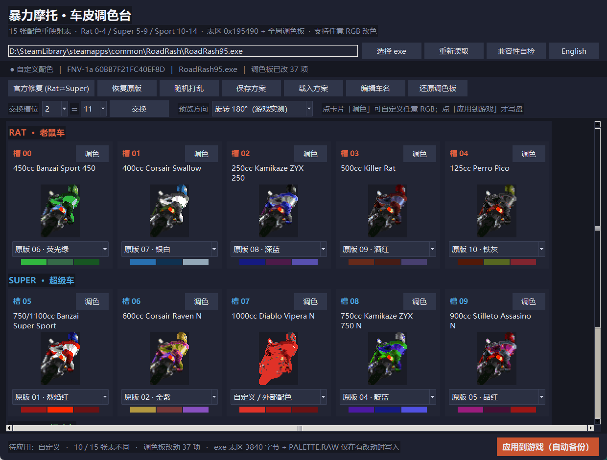
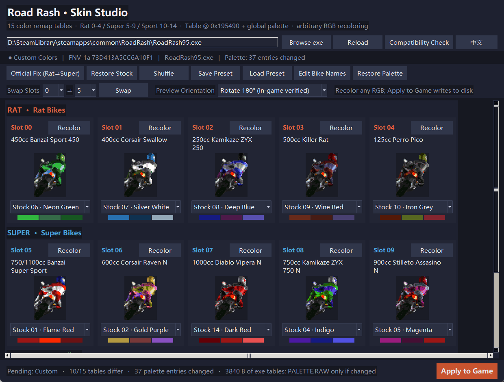

# 暴力摩托 · 车皮调色台 / Road Rash Skin Studio

[English version → README_EN.md](README_EN.md)

给 **Steam 30 周年纪念版《Road Rash》(1996)** 修复「车皮配色错位」并自定义车辆 / 车手配色的 Windows 小工具。

两版都在 [Releases](https://github.com/F1-ZX/RoadRash30-SkinSwap/releases) 提供免安装单文件 EXE，且**两版都内置简体中文 / English 双语界面**，可一键切换。

> 直接下载：[**v2.0（推荐）· 任意 RGB 改色**](https://github.com/F1-ZX/RoadRash30-SkinSwap/releases/tag/v2.0) · [**v1.0 轻量版 · 车皮排列**](https://github.com/F1-ZX/RoadRash30-SkinSwap/releases/tag/v1.0)
>
> 仓库：<https://github.com/F1-ZX/RoadRash30-SkinSwap>

---

## 这个 Bug 是什么

PC 移植版把车手精灵的颜色抽出来做成了运行时查表：精灵里只存 0–255 的「灰度索引」，最终颜色由

```
最终颜色 = PALETTE.RAW[ LUT[ 精灵像素索引 ] ]
```

决定。`RoadRash95.exe` 里存着 **15 张 × 256 字节**的颜色查找表（LUT），按车辆 spec number 索引：`0–4 Rat`、`5–9 Super`、`10–14 Sport`。

30 周年版把 **Rat 与 Super 两组各 5 张表整体装反了** —— 商店里的车图（独立 JPEG）是对的，但比赛里的 3D 车与车手配色全错。Fandom Wiki 与 `RR30th_BCFIX` 补丁都记录了这一点。官方修复就是交换 `(0,5) (1,6) (2,7) (3,8) (4,9)` 五对表，Sport 的 10–14 从未改动。

本工具直接改写 exe 内这 3840 字节，不替换、不注入、不依赖任何外部 DLL。

---

## 两个版本怎么选

| | **v1.0** | **v2.0（推荐）** |
|---|---|---|
| 修复 Rat⇄Super 错位 | ✅ | ✅ |
| 15 套内置配色的指派 / 交换 / 随机 / 方案存读 | ✅ | ✅ |
| 任意 RGB 改色（突破 256 色库） | — | ✅ |
| 真实车皮预览 + 主色色带 | ✅ | ✅ |
| 编辑车名 / 兼容性自检 / 预览方向切换 | ✅ | ✅ |
| 写入的文件 | 只写 exe | exe + `DATA/PALETTE.RAW` |
| 简体中文 / English 界面 | ✅ | ✅ |

> v1.0 保留为轻量版：只动一个文件、只排列内置配色，适合想最小改动的人。
> 两版 Release 里的 EXE 都是「加了英文支持的最终构建」。

---

## 快速开始（玩家）

1. 在 [Releases](https://github.com/F1-ZX/RoadRash30-SkinSwap/releases) 下载 `RoadRashSkinStudio_v2.0.exe`（推荐）或 `RoadRashSkinStudio_v1.0.exe`（轻量版）。EXE 可任意重命名，双击即可运行。
2. 双击运行。程序会自动探测 Steam 库（含 `libraryfolders.vdf` 与其它盘符）；找不到就点 **选择 exe / Browse exe** 手动定位 `RoadRash95.exe`。
3. **语言**：中文系统默认简体中文，其它系统默认 English。点路径栏最右侧的 **English / 中文** 按钮即可切换（程序会重启一次，选择被记住）。
4. 修复 Bug：点 **官方修复 (Rat⇄Super) / Official Fix**；或直接在卡片下拉框里给任意槽位指派配色。
5. v2.0 想自己调色：点卡片上的 **调色 / Recolor**（也可双击预览图）→ 选一种颜色 → 取色或直接填 HEX → **应用该颜色**。
6. 最后点 **应用到游戏 / Apply to Game** 才会写盘。程序会先为被修改的文件各建一份带时间戳的备份。
7. 从 Steam 正常启动游戏即可生效。

---

## 它到底改了什么

| 文件 | 改写范围 | 保护 |
|---|---|---|
| `RoadRash95.exe` | 文件偏移 `0x195490` 起的 **3840 字节**（15×256） | 写前逐张校验 `00 01` 表头与文件长度；写后逐字节回读；自动备份 |
| `DATA/PALETTE.RAW`（仅 v2.0 且有自定义颜色时） | 1024 字节调色板中若干项的 RGB | 长度校验；写后回读；自动备份；任一文件失败自动回滚两者 |

表区之外**一个字节都不碰**，也不改 PE 头、导入表、资源段、节数量。详见 [兼容性说明](docs/COMPATIBILITY.md)。

---

## 兼容性

工具与**汉化补丁、宽屏 / 分辨率补丁、HD 补丁互不影响**，可任意组合。实测依据（本机）：

- 分辨率 / HD 补丁安装前后 exe 从 1,803,264 B 变为 1,804,800 B，但 `.data` 段 raw 偏移恒为 `0x18CA00`，表区 3840 字节零差异，FNV-1a 前后同为 `0x51D083B966BD8657`。
- `RoadRashHD.dll` / `RASHICON.DLL` / `RASHPROP.DLL` / `AWEMAN32.DLL` 中对表区 VA `0x596A90` 的引用均为 0 处。
- 汉化补丁改的是资源段与文本，同样不在表区。

界面里的 **兼容性自检 / Compatibility Check** 按钮会在你的机器上现场重算这些结论。

**三点前提**：

1. 仅适用于 **Steam 30 周年版 exe**（表区偏移固定）；写前的表头校验会在版本不符时拒绝写入。
2. Steam「校验游戏文件完整性」、游戏更新、重装汉化 / HD 补丁**可能还原 exe 与调色板**，之后重新应用一次即可。
3. 若安装了 `magoowa/RoadRash30-MultiFix` 并开启 `FixBikeColors`：它只在表区哈希等于原版时才交换，自定义配色不会被覆盖。

`PALETTE.RAW` 是车手、赛道、UI 共享的全局调色板。v2.0 会优先直接改写「仅本车引用」的项，共用项则自动隔离到与目标色最接近的空闲项，把副作用降到最低 —— 但**无法静态保证赛道 / UI 绝不变色**。改完进游戏扫一眼即可，不满意点 **还原调色板 / Restore Palette** 可完整回滚。

---

## 界面预览

| 中文主界面 | English 主界面 |
|---|---|
|  |  |

v2.0 调色编辑器：[中文](docs/screenshots/调色编辑器_中文.png) · [English](docs/screenshots/调色编辑器_英文.png)

---

## 源码结构

```
src/        v2.0 源码（单文件 pyw + 生成模板 + 内嵌数据 + 图标）
v1.0/       v1.0 源码（同样支持双语）
tools/      双语注入、单文件生成、端到端自测脚本
docs/       原理考据、兼容性证据、构建说明、截图
```

`车皮调色台.pyw` 是**零第三方依赖**的单文件程序，只依赖 Python 标准库 + tkinter；编译发布用 [PyInstaller](https://pyinstaller.org/)。想从源码构建或跑自测，见 [docs/BUILD.md](docs/BUILD.md)。

---

## 版权与致谢

本仓库**不包含任何游戏可执行文件、商店图片或第三方补丁包**。`src/tool_data.json` 里只含为实时预览所必需的极小派生数据（2160 字节精灵索引、1024 字节调色板、3840 字节原版 LUT、206 个活跃索引），均从用户自己的游戏安装中提取，仅用于互操作与个人修改。原游戏及全部原始资源的版权归其各自权利人所有。本项目与 Electronic Arts / 相关发行方无任何关联，非官方工具。详见 [NOTICE.md](NOTICE.md)。

技术依据与致谢：

- neparij 在 [DxWnd / SourceForge 讨论串](https://sourceforge.net/p/dxwnd/discussion/general/thread/e080095150/) 对 HIBOB.DAT 灰度索引、15 张 256 字节 LUT、PALETTE.RAW 的分析与 15 张预览 BMP
- Anakin94 的 `RR30th_BCFIX` 30 周年版车皮修复
- [magoowa/RoadRash30-MultiFix](https://github.com/magoowa/RoadRash30-MultiFix) —— 源码注释中 `15 tables at 0x596a90, indexed by the bike's spec number` 与 FNV-1a 校验值
- [Road Rash Wiki (Fandom)](https://roadrash.fandom.com/) 关于 PC 版 Rat / Super 调色板互换的记载

代码采用 [MIT License](LICENSE)。
