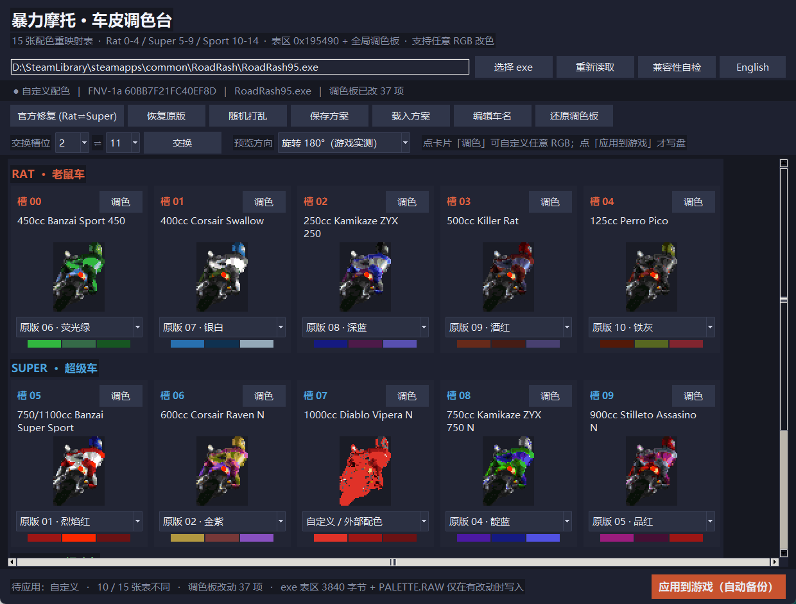
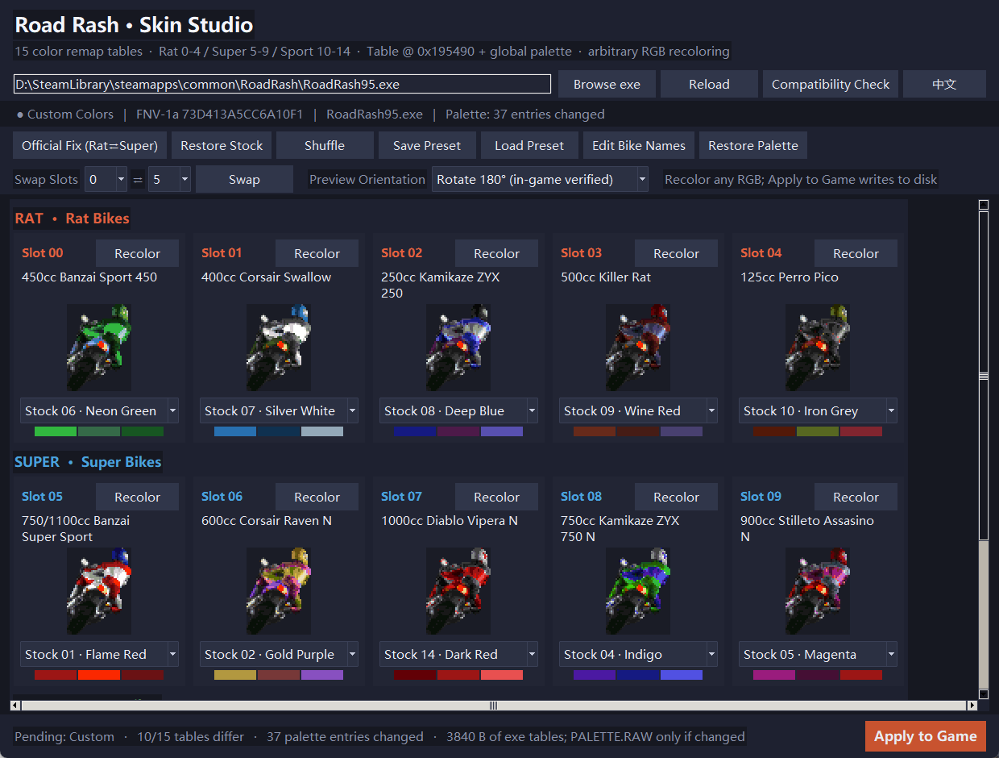

# Road Rash Skin Studio

[中文说明 → README.md](README.md)

A small Windows tool for the **Steam 30th Anniversary edition of Road Rash (1996)**. It fixes the infamous swapped bike / rider colors and lets you customize every bike skin.

Both versions ship as standalone EXEs on the [Releases](https://github.com/F1-ZX/RoadRash30-SkinSwap/releases) page, and **both include a Simplified Chinese / English UI with a one-click language switch**.

> Direct downloads: [**v2.0 (recommended) — free RGB recolor**](https://github.com/F1-ZX/RoadRash30-SkinSwap/releases/tag/v2.0) · [**v1.0 lightweight — palette swap**](https://github.com/F1-ZX/RoadRash30-SkinSwap/releases/tag/v1.0)
>
> Repository: <https://github.com/F1-ZX/RoadRash30-SkinSwap>

---

## The bug

The PC port stores rider sprites as 8-bit "grayscale" indices and resolves the final color at runtime:

```
final color = PALETTE.RAW[ LUT[ sprite pixel index ] ]
```

`RoadRash95.exe` contains **15 × 256-byte color lookup tables (LUTs)** indexed by the bike's spec number: `0–4 Rat`, `5–9 Super`, `10–14 Sport`.

In the 30th Anniversary build, **the two groups of five tables (Rat and Super) are swapped**. The showroom JPEGs are correct, but the in-race 3D bikes and riders wear the wrong colors. The official fix simply swaps the five pairs `(0,5) (1,6) (2,7) (3,8) (4,9)`; tables 10–14 (Sport) were never affected.

This tool rewrites those 3840 bytes in-place — no file replacement, no DLL injection, no runtime hooks.

---

## Which version?

| | **v1.0** | **v2.0 (recommended)** |
|---|---|---|
| Fix Rat⇄Super swap | ✅ | ✅ |
| Assign / swap / shuffle the 15 built-in palettes, save & load presets | ✅ | ✅ |
| Arbitrary RGB recoloring (break out of the 256-color library) | — | ✅ |
| Live sprite preview + dominant color swatches | ✅ | ✅ |
| Edit bike names / compatibility self-check / preview orientation | ✅ | ✅ |
| Files written | exe only | exe + `DATA/PALETTE.RAW` |
| Simplified Chinese / English UI | ✅ | ✅ |

> v1.0 stays as the minimal version: one file, built-in palettes only.
> Both Release EXEs are the final builds **with English support**.

---

## Quick start

1. Download `RoadRashSkinStudio_v2.0.exe` (recommended) or `RoadRashSkinStudio_v1.0.exe` (lightweight) from [Releases](https://github.com/F1-ZX/RoadRash30-SkinSwap/releases). No Python installation needed; the EXE can be renamed freely.
2. Run it. The tool auto-detects your Steam library (including `libraryfolders.vdf` and other drive letters); otherwise click **Browse exe** and point it at `RoadRash95.exe`.
3. **Language**: Chinese systems default to Simplified Chinese, everything else defaults to English. Click the **English / 中文** button at the right end of the path row to switch (the app restarts once; the choice is remembered).
4. To fix the bug, click **Official Fix (Rat⇄Super)** — or use the dropdown on any card to assign any built-in palette.
5. v2.0 only: click **Recolor** on a card (or double-click its preview) → select a color → pick any RGB / enter a HEX value → **Apply Color**.
6. Nothing is written to disk until you click **Apply to Game**. Timestamped backups are created automatically for every modified file.
7. Launch the game from Steam.

---

## What exactly gets modified

| File | Range | Safeguards |
|---|---|---|
| `RoadRash95.exe` | **3840 bytes** at file offset `0x195490` (15×256) | Validates all 15 `00 01` table signatures and file size before writing; byte-for-byte readback after writing; automatic backup |
| `DATA/PALETTE.RAW` (v2.0, only with custom colors) | RGB of selected entries in the 1024-byte palette | Size validation; readback; automatic backup; if either write fails, both files are rolled back |

**Not a single byte outside the table region is touched** — PE headers, import table, resources and section count stay intact. See [COMPATIBILITY.md](docs/COMPATIBILITY.md).

---

## Compatibility

The tool is independent of the **Chinese localization patch, widescreen / resolution patch and HD patch**; any combination works. Measured on the author's machine:

- exe size went 1,803,264 B → 1,804,800 B after the widescreen/HD patch, but `.data` raw offset stayed `0x18CA00`, the 3840-byte table region was byte-identical, and FNV-1a stayed `0x51D083B966BD8657`.
- `RoadRashHD.dll`, `RASHICON.DLL`, `RASHPROP.DLL` and `AWEMAN32.DLL` contain **zero** references to the table VA `0x596A90`.
- The localization patch edits the resource section and text — also outside the table region.

The **Compatibility Check** button recomputes all of the above on your own machine.

Three caveats:

1. Only for the **Steam 30th Anniversary exe** (fixed table offset). Signature validation refuses to write on an unknown build.
2. Steam's "Verify integrity", game updates, or reinstalling localization / HD patches may restore the exe and palette — just apply again.
3. With `magoowa/RoadRash30-MultiFix` and `FixBikeColors` enabled: it only swaps when the table hash equals stock, so custom colors are never overwritten.

`PALETTE.RAW` is a **global palette shared by riders, track and UI**. v2.0 prefers rewriting entries used only by the selected bike; shared entries are isolated to the free entry closest to your target color. This minimizes side effects but cannot statically guarantee the track/UI never changes. Take a look in-game, and use **Restore Palette** for a complete rollback.

---

## Screenshots

| Chinese | English |
|---|---|
|  |  |

v2.0 color editor: [Chinese](docs/screenshots/调色编辑器_中文.png) · [English](docs/screenshots/调色编辑器_英文.png)

---

## Source layout

```
src/        v2.0 sources (single-file pyw + generation template + embedded data + icon)
v1.0/       v1.0 sources (also bilingual)
tools/      i18n injection, single-file generator, end-to-end tests
docs/       technical notes, compatibility evidence, build guide, screenshots
```

`车皮调色台.pyw` is a **zero-dependency single file**: Python standard library + tkinter only. Release EXEs are built with [PyInstaller](https://pyinstaller.org/). See [docs/BUILD.md](docs/BUILD.md).

---

## Legal & credits

This repository contains **no game executables, showroom images or third-party patch archives**. `src/tool_data.json` holds only the tiny derived datasets required for live preview (2160-byte sprite index map, 1024-byte palette, 3840 bytes of stock LUTs, 206 active indices), extracted from the user's own installation and used solely for interoperability and personal modification. The game and all original assets belong to their respective rights holders. This project is unofficial and is not affiliated with or endorsed by Electronic Arts or any related publisher. See [NOTICE.md](NOTICE.md).

Technical references and thanks:

- neparij's [DxWnd / SourceForge thread](https://sourceforge.net/p/dxwnd/discussion/general/thread/e080095150/) — HIBOB.DAT grayscale indices, the 15 × 256-byte LUTs, PALETTE.RAW and 15 preview BMPs
- Anakin94's `RR30th_BCFIX` for the 30th Anniversary build
- [magoowa/RoadRash30-MultiFix](https://github.com/magoowa/RoadRash30-MultiFix) — the `15 tables at 0x596a90, indexed by the bike's spec number` comment and the FNV-1a constant
- [Road Rash Wiki (Fandom)](https://roadrash.fandom.com/) for documenting the PC Rat/Super palette swap

Code is licensed under the [MIT License](LICENSE).
